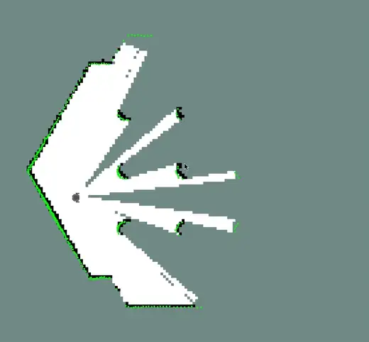

# RRT Explorer

A ROS (catkin) package for autonomous exploration of unknown environments using
RRT-based frontier detection. The robot grows Rapidly-exploring Random Trees on
the SLAM occupancy grid to find frontiers (boundaries between known free space
and unknown space), clusters and filters them, and sends the best frontier to
`move_base` as a navigation goal.

It targets the TurtleBot3 with gmapping SLAM, on ROS Noetic (Python 3).



*TurtleBot3 Burger exploring `turtlebot3_world` in Gazebo (first 120 s, 5× speed).
Red: global RRT tree. Yellow: frontier clusters. Blue: planned path.*

## How it works

```
 /map (SLAM) ──┬──► global_rrt ──┐
               │                 ├──► /detected_points ──► filter.py ──► /filtered_points ──► task_allocator ──► move_base
               └──► local_rrt  ──┘     (PointStamped)      (MeanShift +      (PointArray)       (picks goal)
                                                             costmap check)
```

1. **Global RRT detector** (`global_rrt`, C++): grows one tree over the whole
   exploration region and never resets, so it finds frontiers anywhere in the map.
2. **Local RRT detector** (`local_rrt`, C++): grows a tree from the robot. Each
   time it finds a frontier, it discards the tree and starts again from the
   robot's current pose, so it keeps finding frontiers close to the robot.
3. **Filter** (`filter.py`): collects detected points, clusters them with
   MeanShift (bandwidth 0.3 m), and drops centroids that sit on high-cost cells
   in the global costmap or have too little information gain (unknown area
   nearby). Publishes the remaining centroids.
4. **Task allocator** (`task_allocator_node.py`): scores frontiers by
   navigation cost (distance) and information gain, and sends the chosen one to
   `move_base` as a goal.

Both RRT detectors use a frontier check (`ObstacleFree` in `src/helper.cpp`): a
new edge that reaches unknown space is reported as a frontier, a collision-free
edge is added to the tree, and an edge through an obstacle is discarded.

## Dependencies

- ROS Noetic, with `roscpp`, `rospy`, `tf`, `std_msgs`, `geometry_msgs`,
  `nav_msgs`, `visualization_msgs`, `actionlib`, `move_base_msgs`
- TurtleBot3 packages: `turtlebot3_bringup`, `turtlebot3_slam`,
  `turtlebot3_navigation` (and `turtlebot3_gazebo` for simulation)
- `gmapping` (default SLAM method)
- Python: `numpy`, `scikit-learn`

```bash
sudo apt install ros-noetic-turtlebot3 ros-noetic-turtlebot3-simulations \
                 ros-noetic-slam-gmapping ros-noetic-navigation
pip3 install numpy scikit-learn
```

## Build

```bash
cd ~/catkin_ws/src
git clone git@github.com:mathaimp/rrt_explorer.git
cd ~/catkin_ws
catkin_make
source devel/setup.bash
```

## Usage

Set the TurtleBot3 model, then start a robot or a simulation:

```bash
export TURTLEBOT3_MODEL=burger
roslaunch turtlebot3_gazebo turtlebot3_world.launch
```

Launch SLAM, `move_base`, RViz and the explorer:

```bash
roslaunch rrt_explorer all.launch
```

The explorer stack can also be launched on its own (if SLAM and `move_base`
are already running):

```bash
roslaunch rrt_explorer rrt.launch
```

### Defining the exploration region

The RRT nodes wait for **5 points** from RViz's **Publish Point** tool
(`/clicked_point`) before they start:

1. Points 1–4: corners of the region to explore. Points 1 and 3 must be
   **opposite corners**, because they define the bounding box.
2. Point 5: where the tree starts. Pick a point in known free space, usually
   near the robot.

## Launch files

| File | Description |
| --- | --- |
| `all.launch` | SLAM + `move_base` + explorer. Arg `explorer` (default `rrt`) chooses which `<explorer>.launch` to include. |
| `rrt.launch` | Global/local RRT detectors, filter and task allocator. |
| `turtlebot3_slam.launch` | TurtleBot3 bringup + SLAM (`slam_methods`, default `gmapping`) + RViz. |
| `turtlebot3_navigation.launch` | Navigation on a saved map: map_server + AMCL + `move_base` + RViz. |

## Nodes

### `global_rrt` / `local_rrt`

| | Name | Type |
| --- | --- | --- |
| Sub | `<map_topic>` | `nav_msgs/OccupancyGrid` |
| Sub | `/clicked_point` | `geometry_msgs/PointStamped` |
| Pub | `/detected_points` | `geometry_msgs/PointStamped` |
| Pub | `~shapes` (local) / `<node name>_shapes` (global) | `visualization_msgs/Marker` |

| Param | Default | Value in `rrt.launch` | Description |
| --- | --- | --- | --- |
| `~eta` | `0.5` | global `15.0`, local `1.0` | RRT step size (m) |
| `~map_topic` | `/map` | `/map` | Occupancy grid topic |
| `~robot_frame` | `/base_link` | `/base_link` | Robot frame (`local_rrt` resets the tree here) |

### `filter.py`

| | Name | Type |
| --- | --- | --- |
| Sub | `<map_topic>` | `nav_msgs/OccupancyGrid` |
| Sub | `<global_costmap_topic>` | `nav_msgs/OccupancyGrid` |
| Sub | `<goals_topic>` | `geometry_msgs/PointStamped` |
| Pub | `filtered_points` | `rrt_explorer/PointArray` |
| Pub | `frontiers`, `centroids` | `visualization_msgs/Marker` |

| Param | Default | Description |
| --- | --- | --- |
| `~map_topic` | `map` | Occupancy grid topic |
| `~goals_topic` | `/detected_points` | Raw frontier points from the detectors |
| `~global_costmap_topic` | `/move_base/global_costmap/costmap` | Costmap used to drop unreachable frontiers |
| `~costmap_clearing_threshold` | `70` | Costmap value above which a frontier is dropped |
| `~info_radius` | `1.0` | Radius (m) for the information gain check |
| `~n_robots` | `1` | Number of robots |
| `~namespace` | `""` | Robot namespace prefix (multi-robot) |
| `namespace_init_count` | `1` | Index of the first robot namespace |
| `~robot_frame` | `base_link` | Robot frame |
| `~rate` | `100` | Loop rate (Hz) |

### `task_allocator_node.py`

Subscribes to `filtered_points`, `map`, `odom` and `move_base/status`, and sends
goals through the `move_base` action server. A frontier's score is
`alpha * distance + beta * information_gain`, and the frontier with the lowest
score is chosen. A goal that is not reached within 30 s is cancelled, and
frontiers within 0.5 m of a failed goal are skipped afterwards.

## Messages

- `rrt_explorer/PointArray`: `geometry_msgs/Point[] points`

## Repository layout

```
include/   helper.h (RRT primitives), mtrand.h (Mersenne Twister RNG)
src/       global_rrt.cpp, local_rrt.cpp, helper.cpp, mtrand.cpp
scripts/   filter.py, task_allocator_node.py, helper.py (map/robot utilities)
launch/    launch files (see above)
msg/       PointArray.msg
docs/      demo recording
```

## Acknowledgements

The detector design (global and local RRT, MeanShift filter, information gain
utilities) follows the approach of Umari & Mukhopadhyay, *"Autonomous robotic
exploration based on multiple rapidly-exploring randomized trees"* (IROS 2017),
and its reference implementation `rrt_exploration`.
